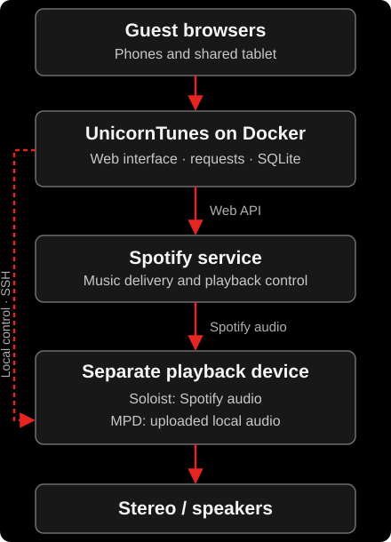

<p align="center">
  
</p>

# UnicornTunes

**A shared music-request jukebox with a Docker-hosted web interface and a separate Spotify Soloist playback device.**

Guests open a URL or scan a QR code to search music, browse host-selected playlists and House Favorites, request songs, and vote. The host controls the session, music rules and room configuration through `/host`. Spotify Soloist runs on a separate playback device connected to the stereo; it is not included in the UnicornTunes Docker image.

## How it works

<p align="center">
  
</p>

UnicornTunes manages requests, fairness, votes, guest identity, curation and history. Spotify's service delivers audio to Soloist. The browser and Docker web app do not output the music; the optional web-side artwork processor only creates cover thumbnails. Playback control currently uses Spotify's Web API; Soloist's optional local WebSocket API is not required or exposed to guests.

## Requirements

- A Docker host with Docker Compose and a persistent data volume.
- A **separate playback device running [Spotify Soloist](https://developer.spotify.com/documentation/soloist)**, with working audio output to the stereo. The current installation uses a Pine64 Linux device. Follow Spotify's supported platform and audio requirements.
- A Spotify Premium host account, a Spotify Web API application, and a Soloist API key. Pair Soloist with the same account authorized in UnicornTunes.
- A URL reachable by guest phones and the tablet. Use trusted HTTPS for normal browser sign-in; an HTTP installation can use the documented loopback OAuth fallback.

The Web API Client ID/OAuth authorization, Soloist API key and UnicornTunes host password serve different purposes. Soloist's key stays on the playback device; guest browsers never receive Spotify tokens.

## Deploy and update

Follow **[DEPLOY.md](DEPLOY.md)** for complete setup, persistent storage, reverse proxy, host password and Spotify authorization instructions.

The standard image is:

```env
FOXTUNES_IMAGE=ghcr.io/natsteff/unicorntunes:latest
```

After preparing `compose.yml` and `.env` as described in the deployment guide:

```sh
docker compose pull
docker compose up -d
```

Use the same two commands for future releases. Numbered image tags are also published for rollback. The running build version appears beneath the logo. Refresh the page after an update.

The Compose project remains `foxtunes` to preserve existing container/network/volume identity. `FOXTUNES_*` settings and internal filenames are retained for compatibility. Keep your current data volume when updating.

## Safe updates, backups and rollback

Run deployment commands on the Docker host, in the directory containing the installation's existing `compose.yml` and `.env`. A GitHub source update alone does not update a running container: pull the published image and recreate the service. Keep the same Compose project, service, image configuration and data volume. Record the current numbered release before updating; `latest` can move.

Before an update, stop request handoff in the host desk. Lower the final speaker level if device maintenance is also planned. Back up `.env` and Compose configuration securely and take a consistent backup of **all** `/data` (database, configuration, tokens, host password, local-player key and pinned host keys). Stop the web container while copying; copying only a live SQLite file can miss journal/WAL data. For a standard existing Compose deployment, this example creates a private backup on the Docker host:

```sh
umask 077
ut_backup_dir="$(pwd)/unicorntunes-backup-$(date +%Y%m%d-%H%M%S)"
mkdir -p "$ut_backup_dir/data"
cp compose.yml .env "$ut_backup_dir/"
docker compose stop foxtunes
ut_container_id=$(docker compose ps -aq foxtunes)
test -n "$ut_container_id" && docker cp "$ut_container_id:/data/." "$ut_backup_dir/data/"
```

Check that the copy succeeded and contains `web.sqlite3` and the expected private configuration before proceeding. If backup fails, stop here and restart the existing service with `docker compose start foxtunes`; resolve the backup failure before updating. Protect backups from other users, public shares and Git. The archive contains credentials. Preserve a known-good backup separately from the live volume.

Then update and verify:

```sh
docker compose pull foxtunes
docker compose up -d foxtunes
docker compose ps foxtunes
docker compose logs --tail=60 foxtunes
```

Review logs privately before sharing. Refresh the browser and confirm the version beneath the logo matches the intended release. Sign in, test the local connection if enabled, refresh Spotify devices, choose the correct player and explicitly start the session. Check one request and a source transition at a conservative speaker level. Container recreation preserves stored data but stops automatic handoff and expires host sessions by design. It need not stop audio already playing independently on the playback device.

For reproducible deployments, set `FOXTUNES_IMAGE` to a published numbered tag rather than `latest`. To roll back, stop the service, restore the prior image tag in `.env`, and restore its matching full data backup when migrations changed stored data. Use the Docker host's volume restore tools and preserve the container's non-root ownership (UID 10001). Restore into the existing intended volume with the service stopped; verify the target before replacing anything. Pull/recreate, verify the displayed version and explicitly restart handoff. An older image with a newer database is not a guaranteed safe rollback. Never use `docker compose down -v` for an update: it deletes the named data volume. See [deployment and persistence](DEPLOY.md#persistence-updates-and-rollback).

Docker updates do not update Soloist, the operating system or the restricted MPD agent. Follow the [agent update procedure](LOCAL_FILES.md#update-the-playback-device) for the required published agent version; review/download the versioned helper and run it as the existing audio user. The helper updates the agent without restarting MPD or Soloist; verify its reported version and test the host connection afterward. Keep the SSH key and host-key pin; do not disable host-key checking to resolve an address change. Back up device service/configuration and paired state privately before Soloist or system upgrades. Use the appropriate vendor binary, retain a working version, and schedule an audio interruption. Test reboot startup without first logging into the device. Do not overwrite a working service or pairing state merely to update the Docker image.

### Pine64 maintenance

The Docker app, Spotify Soloist and the restricted MPD agent are updated separately. **UnicornTunes v0.8.2 needs only the Docker update** for local-library browsing and automatic local-track handoff. Update the restricted agent only when a release lists a required agent version for a feature. Run **Scan library changes** after adding, replacing or removing local music.

Spotify says Soloist builds expire after **90 days**. Use the installed build timestamp to plan the next update and allow time before expiry. For Garage, download the **Linux ARM64** build, replace the executable during a maintenance window and verify playback. See [Spotify’s expiry policy](https://developer.spotify.com/documentation/soloist) and the [Pine64 maintenance procedure](SOLOIST_DEVICE_SETUP.md#update-spotify-soloist).

## Volume adjustment and distortion

These controls act at different stages. A high percentage is not a loudness target, and increasing every stage can cause clipping before the final speaker control can reduce it.

| Stage | Where to adjust | Effect and persistence |
| --- | --- | --- |
| Spotify/Soloist stream | Spotify Connect volume, or the playback device's audio-session stream controls | Spotify audio only. Runtime stream IDs and levels can change when Soloist restarts; verify startup configuration and actual restored level. Host desk → Player settings → Volume controls can set the level if Spotify reports volume support for the selected player. |
| Device output/sink | Host desk → Player settings → Volume controls, or `pactl` as the audio user | Overall output for streams routed to that sink, potentially including both Spotify and MPD. Connecting another output can change routing; confirm the actual sink. The web control requires agent 8 and a linked PulseAudio player. Reboot persistence depends on the installed audio setup. |
| MPD manual local volume | Host desk → Player settings → Volume controls → Apply local volume | Local files only; does not change Spotify or the amplifier. Saved in UnicornTunes. With automatic levels enabled, calculated per-track levels apply instead; use the loudness target/reference controls for calibration. |
| Cached loudness matching | Player settings → Volume controls → Local library scan & loudness matching | Measures original local files and applies per-track MPD software volume. Settings/cache persist; changed files need analysis. It cannot boost above unity or guarantee every target is reachable. |
| Final speaker/amplifier | Physical output device | Listening-room level. Turn it down before changing upstream levels; it cannot undo distortion already introduced upstream. |

A Spotify desktop app is not needed for routine playback. For PulseAudio installations, sign in as the existing audio service user on the playback device and inspect routing first:

```sh
pactl info
pactl list short sinks
pactl list sink-inputs
```

Identify Soloist's current stream and the output actually feeding the speakers; do not guess numeric IDs or apply changes to every stream. After substituting the inspected IDs, these are examples of separate controls:

```sh
pactl set-sink-input-volume SOLOIST_STREAM_ID 60%
pactl set-sink-volume OUTPUT_SINK_ID 65%
```

These commands change live levels; they do not install a persistent startup policy. Run them in the audio user's session, not an unrelated root audio session. Inspect `pactl list sink-inputs` and `pactl list sinks` again to verify the result. Recheck after restarting Soloist, changing outputs and rebooting. Use the installed Soloist version's `--help` and existing service configuration when reviewing startup volume; keep API keys and service arguments private.

In one installation, 95% Soloist stream volume produced audible distortion. A 60% stream with 65% analog output was accepted as a temporary listening balance. These are observations, not universal recommended levels or proof of reboot persistence. MPD's separate 50% manual trial setting did not control Spotify. Begin conservatively, raise one stage in small steps and compare several quiet and loud Spotify/local tracks. If distortion appears, lower the last upstream change before raising the amplifier. Avoid output boost above 100%; investigate routing, gain and hardware rather than stacking boosts. Establish a clean baseline before calibrating local loudness, then validate transitions in both directions. See the [cached loudness guide](LOCAL_FILES.md#cached-loudness-and-automatic-volume-v070).

If playback pauses or disappears, capture the time, host status and player-health result before restarting. Service `active/running` and a visible Spotify device do not prove healthy audio playback. Repeated queue entries do not establish repeat mode by themselves. Review device logs privately for authentication, network, discovery and audio failures; do not assume a one-hour timeout or attribute a stop to Bluetooth without evidence. **Stop session** stops handoff while audio can continue; **Pause playback** pauses audio and stops handoff. When the player is confirmed paused, the button becomes **Resume playback**, which resumes audio only; choose **Start session** separately to enable requests. After recovery, verify the selected device and deliberately start the session again.

## Playback-device setup and rebuilds

See [SOLOIST_DEVICE_SETUP.md](SOLOIST_DEVICE_SETUP.md) for the Linux/Soloist/audio setup, rebuild checklist and optional MPD trial. Confirmed observations and pending validation are marked separately.

## First session

1. Start Soloist on the playback device and pair it through Spotify. Confirm audio reaches the stereo.
2. Open `/host`, sign in with the host password, and authorize Spotify. See the deployment guide for HTTPS login or the HTTP/loopback fallback.
3. Refresh playback devices and select the Soloist device. Saved location names can be assigned to players for later use.
4. Request a song if the player has no playback context, then choose **Start session**. UnicornTunes verifies the selected player before enabling request handoff.
5. Share the guest URL using **Show QR code**, or open `/display` on a shared tablet.

**Stop session** stops new request handoffs while the current music continues. **Pause playback** pauses audio and stops handoff. When the player is confirmed paused, the button becomes **Resume playback**, which resumes audio only; choose **Start session** separately to enable requests. **Skip to next request** respects the protected queue and verifies the resulting playback. Restarting the container preserves data but always leaves handoff stopped until the host starts the session again.

In **Playback**, select the player you want to configure. In **Player settings**, save a Spotify playlist, album or artist as that player's default. **Gathering** can override the default for the current gathering. **Restore player default** clears the override, and **New gathering** also clears it. Existing saved contexts are kept. Saving settings does not start audio.

On an explicit **Start session** with a player that is idle and a clear request queue, UnicornTunes starts the saved background context when configured. Waiting requests take priority, and when the final request ends, UnicornTunes tries to restore the gathering override or player default. If there is no usable context, the host is prompted to choose one. An observed playback failure still requires host review.

To start a session, sign into the Host desk, power on the player and speakers, refresh the player list if needed, and choose the correct player. Check the account shown in **Player & session**, then start and verify both **Running** and audible music. The host can open **How to Start a Session** for these steps and **Setup & troubleshooting** to check authorization and player health. Open the guest page or share the join QR once playback is ready.

**UnicornTunes settings** holds the app-wide guest wording and stats timezone. **Player settings** holds saved locations, the local player connection and volume, background defaults and an optional player-specific welcome heading. A blank player heading inherits the app-wide heading. **Browse Local Files** browses the indexed library linked to the selected player. Search starts at 20 results per page and shows the matching total when provided.

An enabled session stays ready after observed playback exhausts: the next new request starts automatically. Host Pause/Stop remains authoritative; the worker does not restart an arbitrary mid-track pause.

## Host desk navigation

The host desk opens on **Playback**, with session status, now playing, the current player and everyday Pause/Next track/Stop handoff controls. Device selection and request-acceptance edits are drafts until Start, Move or Restart session applies them. **Stop handoff** leaves current audio playing; **Pause music** also stops automatic handoff.

Start is shown when stopped; Stop handoff is disabled when already stopped. During a running session, the start control appears only when changing the player or request settings. Playback actions request an immediate worker check followed by a short burst of faster checks; Spotify can still take time to reflect a change.

Use **Music library** for guest playlist selection, local-file volume and library/loudness maintenance. **Gathering** contains queue rules, guest wording, New gathering and history reset. New gathering archives waiting requests and resets event fairness/Tonight stats; it is separate from restarting playback. **Setup & troubleshooting** holds Spotify authorization, the local-player connection, health/recovery and saved locations. Signing out leaves playback unchanged.

## Guest experience

- Search Spotify by general text, title, artist, album, or release year/range, with optional exact-title matching. Exact matching filters each Spotify result page. Results include album, year and duration.
- Browse House Favorites and playlists enabled by the host, then request individual tracks.
- Enter a name once; skipping uses `<Shy guy - name not provided>`. Phones remember a private guest identity separately from host authorization.
- Requests start with the requester's single vote. Additional guests can each vote once. Names appear in request/vote attribution, and your requests are highlighted.
- View now playing, the shared request queue, a read-only Spotify upcoming snapshot, reactions and Room stats.

Anonymous identity is device/cookie based, not account authentication. Different devices or cleared cookies create different identities. Identical provided names are combined for the casual user leaderboard.

## Legacy tablet kiosk

Open `/legacy` on older tablets for a lightweight guest interface with song/artist search, Spotify/local source selection, requests, votes, now playing and the shared queue. **Kiosk User** is the default name, with an optional **Add your name** control. **Next guest** starts a fresh guest identity. After two minutes without visitor activity, the kiosk clears the name/search and prepares a new identity; requests, votes and historical attribution are retained. Polling does not count as activity, and resets wait for in-flight actions. An unused kiosk does not repeatedly create new identities. The modern `/display` route follows the same visitor behavior; ordinary phone identity behavior is unchanged. Host administration remains at `/host`.

The legacy page uses separate assets, ES5 JavaScript and XMLHttpRequest. It includes Apple Home Screen web-app metadata and avoids modern dialogs. Live updates preserve search text and keyboard focus. Connection failures disable actions while the page reconnects; failed mutations are never automatically replayed. Check the queue before retrying an action after a timeout.

The page targets iOS 9 Safari, but actual iPad 2 compatibility, Home Screen fullscreen behavior and long-session stability still require device validation. Guided Access can restrict casual access to Safari; unattended reopening after a device reboot is not provided. Modern browsers continue using `/` or `/display`.

## Fair queue

Fair mode is enabled by default:

- Each guest's first request per gathering gets a protected turn.
- One selected next request cannot be bumped by subsequent votes.
- Every third selection goes to the oldest waiting request.
- Other selections prioritize protected first turns, then votes, with arrival order breaking ties.

The protected item is the next **UnicornTunes request**. Spotify's existing queued tracks can still play ahead of it. Already handed-off and uncertain requests stay locked. **New gathering** archives waiting requests and resets first-turn eligibility and Tonight stats, preserving history. It refuses to reset unresolved handoffs.

## Host-selected playlists

In `/host`, open **Guest playlist selection** to:

- Load owned/followed playlists, filter the loaded library by name, and load additional pages.
- Search Spotify playlists, or preview a playlist by its Spotify URL/ID.
- Enable individual playlists for guest browsing or disable them later.

Only enabled playlists are exposed through the guest **Playlists** browser. Enabling a private playlist deliberately shares its title and returned tracks with guests. Track pages are paginated and briefly cached across guests. Requests use the same voting, fairness and music rules as song search; browsing never starts a playlist or adds all its tracks.

**Spotify authorization needs `playlist-read-private` and `playlist-read-collaborative` in addition to playback scopes. Existing installations must reconnect Spotify once to grant these read permissions.** Refreshing old tokens does not add permissions. Use **Connect / reconnect Spotify** with trusted HTTPS, or repeat the loopback sign-in in [DEPLOY.md](DEPLOY.md#spotify-login-http--loopback-fallback).

Spotify may restrict reading playlist contents to playlists the connected account owns or collaborates on. Finding or following a playlist does not guarantee its tracks are accessible to this app. UnicornTunes checks contents access before enabling it and displays access failures rather than publishing an unusable selection.

Local-file entries returned by Spotify are visible with a **Local file · Soloist playback not verified** status. They cannot be requested through the existing Spotify-track playback path. This feature does not download playlists, transfer MP3s, or establish native Soloist local-file support.

An optional [MPD local player](LOCAL_FILES.md) on the playback device supports uploaded music alongside Soloist. Search Spotify and local files together, request either source through the shared queue, and let UnicornTunes coordinate playback. The host configures the address and restricted SSH connection, tests it, and indexes the library. Local playback is linked to the selected Spotify device; Spotify is paused before MPD starts. Optional incremental loudness analysis caches measurements and adjusts MPD volume per original file, without rewriting media or generating audio copies. Final volume balance needs a listening comparison on the installed speakers.

## Host configuration and room features

- **House Favorites:** curate tracks from host search results; guest browsing is sorted by counted plays. Saved tracks remain marked as favorites in fresh searches.
- **Music rules:** explicit-content filtering, maximum track length, blocked tracks/artists, and optional repeat cooldown.
- **Themes:** a theme banner and suggested searches.
- **Website wording:** customize all five text areas, use suggested presets, hide the intro eyebrow, or restore defaults. Original wording remains the default.
- **Saved locations:** assign names to playback devices and start/move the shared session there.
- **Playback health:** handoff state, paused requests/audio, stale observations, unavailable player and host recovery guidance.
- **Tablet view:** `/display` provides larger touch controls and a persistent join QR. Shared-tablet requests ask for a fresh guest identity; guests can use phones for persistent personal identity.
- **Room stats:** recent playback observations, Top 40, additional upvotes, distinct supporters, top users, personal history, recap, weekly trends, monthly anthem and discovery spotlight.

A counted play requires 30 observed seconds or half the duration for short tracks. Seeks and unobserved gaps do not earn listening credit. Counted plays do not assert completed or audibly verified listening, and history is not backfilled from before tracking was installed. See **[ROOM_FEATURES.md](ROOM_FEATURES.md)** for the detailed scheduling, identity, observation and rule definitions.

## Data and recovery

SQLite stores requests, votes, guests, playlist selections, favorites and playback history in the persistent volume alongside server configuration. Spotify credentials and the host password are private files there. Protect the volume and its backups.

Run one web server per database. Server restarts expire host sessions but preserve guest identity and stored Spotify authorization. Browser sessions expire after eight hours; guest browser sessions also expire after 30 minutes without API activity. At the 500-session capacity limit, guest sessions inactive for at least five minutes can be reclaimed; active hosts are retained until their normal expiry. Health checks, static pages/assets and public share/favorites/playlist listings do not allocate browser sessions. Session cleanup does not stop music or remove submitted requests/votes. After expiry, refresh to recover a guest session; host controls require signing in again. An interrupted Spotify mutation becomes uncertain and requires host reconciliation; UnicornTunes does not blindly retry queue additions. Waiting requests replace verified background playback promptly in a running session; a verified requested song retains its turn. Subsequent Spotify requests are normally handed off near the current request's end, without a gapless timing guarantee.

## Development and troubleshooting CLI

The product runs through the Docker web interface. `foxtunes.py` remains an optional OAuth/diagnostic utility, with a separate database for its older CLI request experiments. Do not run its playback experiments against an active web session.

For local source development, use Python 3.11+ (the image uses Python 3.12):

```sh
python3 -m pip install -r requirements.txt
python3 web_server.py
python3 -m unittest discover -s tests -v
```

The source server binds to `http://127.0.0.1:8863` by default; `/host` is the host desk. It needs configured Spotify credentials for real catalog access. Optional CLI setup/login remains available through `python3 foxtunes.py setup` and `python3 foxtunes.py login`; deployment-side sign-in instructions are in [DEPLOY.md](DEPLOY.md).

Automated tests cover authentication, persistence/migrations, queue fairness, playback failure handling, guest attribution, favorites, stats, host configuration and playlist sharing. Live account permissions, deployed-device behavior and audible playback still require verification on the installation.


## Upgrade notes for v0.6.0

This upgrade fixes requested-only play history and performs a **one-time played-history and likes reset after a private SQLite backup**. It preserves requests, votes, guest profiles, favorites, enabled playlists, configuration and playback-copy files. History backups live in the persistent data volume as `web-history-backup-*.sqlite3`. Earlier handed-off requests without verifiable dispatch ownership are held for host reconciliation. Future history resets are available through the authenticated host configuration and also save a backup first.

The first request over background music starts immediately in a running session. A single **Like this song** button replaces the three reactions and remains separate from queue upvotes. Host playback-device diagnostics and explicit Soloist recovery require the v0.6.0 restricted-agent update; see [the local player guide](LOCAL_FILES.md#player-recovery-v060).

For source switching, volume comparison, reboot and multi-phone checks, follow the [deployment acceptance checklist](DEPLOYMENT_CHECKLIST.md). Use the same intended Spotify account for Soloist pairing and UnicornTunes authorization; verify both when migrating accounts.

## Upgrade notes for v0.7.0

Local loudness matching now uses cached analysis and automatic MPD volume on original files. Update the restricted playback-device agent, scan library changes, then explicitly enable automatic levels. New/changed files are analyzed, unchanged files skipped and removed cache entries pruned. Target/reference adjustments reuse measurements. The old generated-copy mode is disabled on upgrade; existing copies are retained but excluded from new playback. See [the loudness guide](LOCAL_FILES.md#cached-loudness-and-automatic-volume-v070).


## Upgrade notes for v0.8.0

The host desk now groups daily playback, music maintenance, room/gathering settings and setup/troubleshooting into separate tabs. Refresh the page after updating. This release fixes waiting requests over background music, adds saved background-context restoration after the last observed request end, and makes Pause/Resume and session controls state-aware. Background music must be a usable playlist/album/artist context; a standalone song or repeated Spotify upcoming entries do not supply one. Choose the context on the Playback tab after selecting your player.

Errors identify the failed Spotify operation without exposing tokens or response bodies. A repeated upcoming snapshot is retained and flagged as unreliable evidence of playback order; the underlying Spotify/Soloist duplication cause remains unconfirmed. Local tests do not establish deployed hardware behavior. Validate a Spotify → request → next request → background sequence on the installed player.

Spotify controls and the new host interface require the Docker update only. Resuming a paused **local MPD** track additionally needs restricted agent 7. Until that optional update, the host shows an explicit update message instead of replaying the file from its beginning. Run the versioned helper as the existing audio user on the playback device:

```sh
curl -fL https://raw.githubusercontent.com/natsteff/unicorntunes/v0.8.0/deploy/update-local-agent.sh -o /tmp/update-unicorntunes-agent.sh
# Review the downloaded script, then:
bash /tmp/update-unicorntunes-agent.sh
```

The helper reports `agent_version: 7` and does not restart Soloist/MPD or alter SSH permissions. Existing local playback and analysis remain compatible with agent 6. After updating, confirm the local connection, test Pause/Resume and check source transitions at a conservative volume.


## Spotify account and playback diagnostics (v0.8.1)

The authenticated host's Playback summary shows the Spotify **display name authorized for UnicornTunes**. Setup & troubleshooting includes its verification time and a Check account button. This is not independent verification of Soloist pairing; pair the playback device with the same intended account. No email or account ID is displayed. Successful lookups are cached for five minutes; failures for one minute. Changing or removing stored authorization invalidates the cache on the next check. An unsuccessful check shows Unable to verify instead of retaining a potentially misleading account name. Account lookups do not run on every playback poll and do not request new scopes.

Structured JSON diagnostics go to container stdout. Run `docker compose logs --since 15m foxtunes` to inspect recent events. Log fields include UTC time, a per-operation correlation ID, host playback actions, Spotify method/endpoint, mutation acceptance or HTTP failure status, elapsed time, observed track/device/playback changes, request IDs/states, dispatch holds and background restoration state. Successful unchanged polls are not logged; slow reads and repeated queue anomalies are logged with suppression. An accepted Spotify command is not proof of observed playback. Pauses without a corresponding host action remain observations, not proof of who issued them.

Under **Setup & troubleshooting → Playback diagnostics**, Download diagnostic report exports the most recent 200 events, up to five pre-failure snapshots and current sanitized state. Snapshots include up to 100 active requests. Reports omit account/guest names, song titles, search queries, raw Spotify bodies/errors, device names/addresses, tokens, cookies, passwords and SSH paths/keys. Track, context and player identifiers are salted hashes consistent within one running process. They change after restart. Reports still contain activity timestamps, internal request IDs and playback timing; review before sharing.

In-memory reports reset when the container restarts; Docker logs follow the existing Compose rotation limit (three files of 5 MB). Recreating/removing the container can discard its old Docker logs. Download a report or save reviewed logs **before** restarting/updating during an incident. These diagnostics do not collect raw Soloist/Pine64 journals, restart the player, retry failed playback commands or change request scheduling. Capture the report while the fault is present, then compare event correlation IDs, timestamps and the failed Spotify operation before choosing recovery actions.

## Upgrade notes for v0.8.3

Run `dcupd` for the Host Desk Home Screen shortcut, background playlist picker, guest wording controls and audio settings. The host can choose a player or gathering playlist by name through **Browse Spotify playlists**. In Music library, **Use for background…** saves to the chosen scope. When no background is configured for the selected player and gathering, Playback shows a warning and a shortcut to the picker.

PulseAudio output volume and managed Soloist updates require restricted agent 8 on the linked Pine64. [Set up scheduled Soloist maintenance](SOLOIST_DEVICE_SETUP.md#scheduled-soloist-maintenance)
