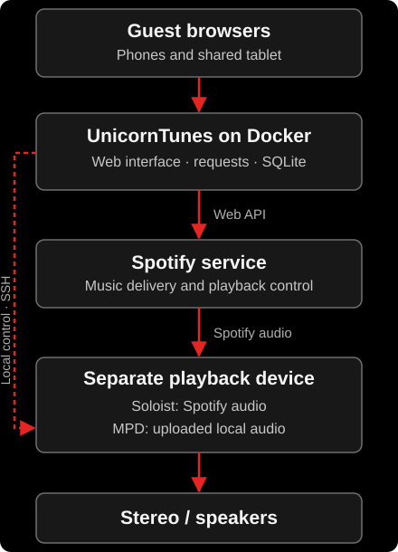

<p align="center">
  
</p>

# UnicornTunes

**A shared music-request jukebox with a Docker-hosted web interface and a separate Spotify Soloist playback device.**

Guests open a URL or scan a QR code to search music, browse host-selected playlists and House Favorites, request songs, and vote. The host controls the session, music rules and room configuration through `/host`. Spotify Soloist runs on a separate playback device connected to the stereo; it is not included in the UnicornTunes Docker image.

## How it works

<p align="center">
  
</p>

UnicornTunes manages requests, fairness, votes, guest identity, curation and history. Spotify's service delivers audio to Soloist. The browser and Docker web app do not output the music; the optional web-side artwork processor only creates cover thumbnails. Playback control currently uses Spotify's Web API; Soloist's optional local WebSocket API is not required or exposed to guests.

## Requirements

- A Docker host with Docker Compose and a persistent data volume.
- A **separate playback device running [Spotify Soloist](https://developer.spotify.com/documentation/soloist)**, with working audio output to the stereo. The current installation uses a Pine64 Linux device. Follow Spotify's supported platform and audio requirements.
- A Spotify Premium host account, a Spotify Web API application, and a Soloist API key. Pair Soloist with the same account authorized in UnicornTunes.
- A URL reachable by guest phones and the tablet. Use trusted HTTPS for normal browser sign-in; an HTTP installation can use the documented loopback OAuth fallback.

The Web API Client ID/OAuth authorization, Soloist API key and UnicornTunes host password serve different purposes. Soloist's key stays on the playback device; guest browsers never receive Spotify tokens.

## Deploy and update

Follow **[DEPLOY.md](DEPLOY.md)** for complete setup, persistent storage, reverse proxy, host password and Spotify authorization instructions.

The standard image is:

```env
FOXTUNES_IMAGE=ghcr.io/natsteff/unicorntunes:latest
```

After preparing `compose.yml` and `.env` as described in the deployment guide:

```sh
docker compose pull
docker compose up -d
```

Use the same two commands for future releases. Numbered image tags are also published for rollback. The running build version appears beneath the logo. Refresh the page after an update.

The Compose project remains `foxtunes` to preserve existing container/network/volume identity. `FOXTUNES_*` settings and internal filenames are retained for compatibility. Keep your current data volume when updating.

## Playback-device setup and rebuilds

See [SOLOIST_DEVICE_SETUP.md](SOLOIST_DEVICE_SETUP.md) for the Linux/Soloist/audio setup, rebuild checklist and optional MPD trial. Confirmed observations and pending validation are marked separately.

## First session

1. Start Soloist on the playback device and pair it through Spotify. Confirm audio reaches the stereo.
2. Open `/host`, sign in with the host password, and authorize Spotify. See the deployment guide for HTTPS login or the HTTP/loopback fallback.
3. Refresh playback devices and select the Soloist device. Saved location names can be assigned to players for later use.
4. Request a song if the player has no playback context, then choose **Start session**. UnicornTunes verifies the selected player before enabling request handoff.
5. Share the guest URL using **Show QR code**, or open `/display` on a shared tablet.

**Stop session** stops new request handoffs while the current music continues. **Pause playback** pauses audio and stops handoff. **Skip to next request** respects the protected queue and verifies the resulting playback. Restarting the container preserves data but always leaves handoff stopped until the host starts the session again.

An enabled session stays ready after observed playback exhausts: the next new request starts automatically. Host Pause/Stop remains authoritative; the worker does not restart an arbitrary mid-track pause.

## Guest experience

- Search Spotify by general text, title, artist, album, or release year/range, with optional exact-title matching. Exact matching filters each Spotify result page. Results include album, year and duration.
- Browse House Favorites and playlists enabled by the host, then request individual tracks.
- Enter a name once; skipping uses `<Shy guy - name not provided>`. Phones remember a private guest identity separately from host authorization.
- Requests start with the requester's single vote. Additional guests can each vote once. Names appear in request/vote attribution, and your requests are highlighted.
- View now playing, the shared request queue, a read-only Spotify upcoming snapshot, reactions and Room stats.

Anonymous identity is device/cookie based, not account authentication. Different devices or cleared cookies create different identities. Identical provided names are combined for the casual user leaderboard.

## Fair queue

Fair mode is enabled by default:

- Each guest's first request per gathering gets a protected turn.
- One selected next request cannot be bumped by subsequent votes.
- Every third selection goes to the oldest waiting request.
- Other selections prioritize protected first turns, then votes, with arrival order breaking ties.

The protected item is the next **UnicornTunes request**. Spotify's existing queued tracks can still play ahead of it. Already handed-off and uncertain requests stay locked. **New gathering** archives waiting requests and resets first-turn eligibility and Tonight stats, preserving history. It refuses to reset unresolved handoffs.

## Host-selected playlists

In `/host`, open **Guest playlist selection** to:

- Load owned/followed playlists, filter the loaded library by name, and load additional pages.
- Search Spotify playlists, or preview a playlist by its Spotify URL/ID.
- Enable individual playlists for guest browsing or disable them later.

Only enabled playlists are exposed through the guest **Playlists** browser. Enabling a private playlist deliberately shares its title and returned tracks with guests. Track pages are paginated and briefly cached across guests. Requests use the same voting, fairness and music rules as song search; browsing never starts a playlist or adds all its tracks.

**Spotify authorization needs `playlist-read-private` and `playlist-read-collaborative` in addition to playback scopes. Existing installations must reconnect Spotify once to grant these read permissions.** Refreshing old tokens does not add permissions. Use **Connect / reconnect Spotify** with trusted HTTPS, or repeat the loopback sign-in in [DEPLOY.md](DEPLOY.md#spotify-login-http--loopback-fallback).

Spotify may restrict reading playlist contents to playlists the connected account owns or collaborates on. Finding or following a playlist does not guarantee its tracks are accessible to this app. UnicornTunes checks contents access before enabling it and displays access failures rather than publishing an unusable selection.

Local-file entries returned by Spotify are visible with a **Local file · Soloist playback not verified** status. They cannot be requested through the existing Spotify-track playback path. This feature does not download playlists, transfer MP3s, or establish native Soloist local-file support.

An optional [MPD local player](LOCAL_FILES.md) on the playback device supports uploaded music alongside Soloist. Search Spotify and local files together, request either source through the shared queue, and let UnicornTunes coordinate playback. The host configures the address and restricted SSH connection, tests it, and indexes the library. Local playback is linked to the selected Spotify device; Spotify is paused before MPD starts. Optional host loudness preparation creates verified level-matched playback copies while preserving originals. Final volume balance needs a listening comparison on the installed speakers.

## Host configuration and room features

- **House Favorites:** curate tracks from host search results; guest browsing is sorted by counted plays. Saved tracks remain marked as favorites in fresh searches.
- **Music rules:** explicit-content filtering, maximum track length, blocked tracks/artists, and optional repeat cooldown.
- **Themes:** a theme banner and suggested searches.
- **Website wording:** customize all five text areas, use suggested presets, hide the intro eyebrow, or restore defaults. Original wording remains the default.
- **Saved locations:** assign names to playback devices and start/move the shared session there.
- **Playback health:** handoff state, paused requests/audio, stale observations, unavailable player and host recovery guidance.
- **Tablet view:** `/display` provides larger touch controls and a persistent join QR. Shared-tablet requests ask for a fresh guest identity; guests can use phones for persistent personal identity.
- **Room stats:** recent playback observations, Top 40, additional upvotes, distinct supporters, top users, personal history, recap, weekly trends, monthly anthem and discovery spotlight.

A counted play requires 30 observed seconds or half the duration for short tracks. Seeks and unobserved gaps do not earn listening credit. Counted plays do not assert completed or audibly verified listening, and history is not backfilled from before tracking was installed. See **[ROOM_FEATURES.md](ROOM_FEATURES.md)** for the detailed scheduling, identity, observation and rule definitions.

## Data and recovery

SQLite stores requests, votes, guests, playlist selections, favorites and playback history in the persistent volume alongside server configuration. Spotify credentials and the host password are private files there. Protect the volume and its backups.

Run one web server per database. Server restarts expire host sessions but preserve guest identity and stored Spotify authorization. An interrupted Spotify mutation becomes uncertain and requires host reconciliation; UnicornTunes does not blindly retry queue additions. Guest requests are handed off near the current track's end, not with a gapless timing guarantee.

## Development and troubleshooting CLI

The product runs through the Docker web interface. `foxtunes.py` remains an optional OAuth/diagnostic utility, with a separate database for its older CLI request experiments. Do not run its playback experiments against an active web session.

For local source development, use Python 3.11+ (the image uses Python 3.12):

```sh
python3 -m pip install -r requirements.txt
python3 web_server.py
python3 -m unittest discover -s tests -v
```

The source server binds to `http://127.0.0.1:8863` by default; `/host` is the host desk. It needs configured Spotify credentials for real catalog access. Optional CLI setup/login remains available through `python3 foxtunes.py setup` and `python3 foxtunes.py login`; deployment-side sign-in instructions are in [DEPLOY.md](DEPLOY.md).

Automated tests cover authentication, persistence/migrations, queue fairness, playback failure handling, guest attribution, favorites, stats, host configuration and playlist sharing. Live account permissions, deployed-device behavior and audible playback still require verification on the installation.


## Upgrade notes for v0.6.0

This upgrade fixes requested-only play history and performs a **one-time played-history and likes reset after a private SQLite backup**. It preserves requests, votes, guest profiles, favorites, enabled playlists, configuration and playback-copy files. History backups live in the persistent data volume as `web-history-backup-*.sqlite3`. Earlier handed-off requests without verifiable dispatch ownership are held for host reconciliation. Future history resets are available through the authenticated host configuration and also save a backup first.

The first request over background music starts immediately in a running session. A single **Like this song** button replaces the three reactions and remains separate from queue upvotes. Host playback-device diagnostics and explicit Soloist recovery require the v0.6.0 restricted-agent update; see [the local player guide](LOCAL_FILES.md#player-recovery-v060).

For source switching, volume comparison, reboot and multi-phone checks, follow the [deployment acceptance checklist](DEPLOYMENT_CHECKLIST.md). The original personal Spotify account remains in use until the guest-account migration is deliberately performed after validation.
